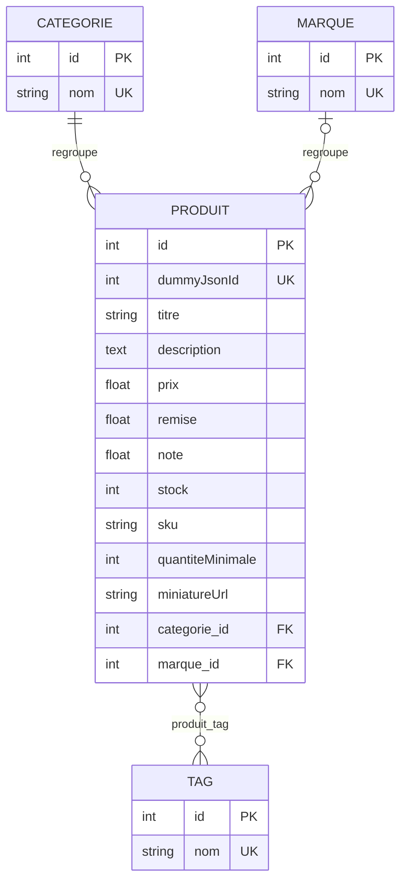

# DummyJson : plateforme de données produits

Projet du cours « Data, API & plateforme » (Bachelor Développement Web, IIM Digital School).

On récupère le catalogue de produits de l'API publique [DummyJSON](https://dummyjson.com/products), on le range dans une base SQLite avec un modèle propre, puis on l'expose avec notre propre API REST.

Auteurs : Cesar Emmanuel Touko Sanama, Christian Kouate Pemen

## Stack

- PHP 8.4 ou plus
- Symfony 8.1
- API Platform 5 (génère l'API et la documentation Swagger)
- Doctrine ORM 3 et Doctrine Migrations
- SQLite
- Symfony HttpClient pour l'appel à DummyJSON

## Installation

Prérequis : PHP 8.4+, Composer, Symfony CLI, Git.

```
git clone https://github.com/Touko74/DummyJson.git
cd DummyJson
composer install
symfony console doctrine:migrations:migrate -n
symfony console app:import-produits
symfony serve -d
```

Ensuite, ouvrir `http://127.0.0.1:8000/api` (Swagger UI). Si `symfony serve` affiche une autre adresse, utiliser celle-là.

L'import peut être relancé autant de fois qu'on veut : au deuxième lancement, tous les produits sont déjà en base et rien n'est dupliqué.

Si la première page met trop de temps à s'ouvrir (le cache se construit), lancer `symfony console cache:clear` puis recharger.

## Architecture

Trois étages :

1. **Source** : DummyJSON, un seul appel `GET /products?limit=0&select=...` qui renvoie tout le catalogue.
2. **Stockage** : base SQLite, remplie par la commande `app:import-produits`.
3. **Exposition** : API REST générée par API Platform à partir des entités.

Dans la source : 194 produits, 24 catégories, 64 marques, 138 tags, dont 92 produits sans marque.

## Modèle de données

Quatre entités. Catégorie, marque et tag se répètent d'un produit à l'autre dans la source : on en fait des tables à part pour ne pas avoir « Beauty » et « beauty » comptés comme deux catégories, et pour pouvoir compter et filtrer.



### Relations

| Relation | Type | Obligatoire | En base |
|---|---|---|---|
| Produit → Catégorie | ManyToOne | oui | colonne `categorie_id` dans `produit` |
| Produit → Marque | ManyToOne | non | colonne `marque_id` dans `produit`, nullable |
| Produit ↔ Tag | ManyToMany | non | table de jointure `produit_tag` |

- La catégorie est toujours présente dans la source, on l'exige. Un produit sans catégorie est ignoré à l'import.
- La marque manque sur 92 produits sur 194. On garde ces produits avec une marque vide.
- Produit est le côté propriétaire des trois relations. Les propriétés `produits` de Catégorie, Marque et Tag sont le côté inverse : elles servent à naviguer, rien n'y est stocké.

### Clés

| | Clé technique | Clé naturelle |
|---|---|---|
| Rôle | relier les tables entre elles | ne pas dupliquer à chaque import |
| Produit | `id` | `dummyJsonId` (l'id de DummyJSON) |
| Catégorie, Marque, Tag | `id` | `nom` (unique) |

Le `sku` est unique dans la source mais nullable chez nous, donc il ne peut pas servir de clé naturelle. L'id de DummyJSON est toujours présent.

## Mapping des champs

Un produit DummyJSON a 22 champs : 13 sont importés, 9 sont ignorés.

### Champs importés

| Champ source | Propriété | Type | Nullable | Unique | Contraintes | Règle d'import |
|---|---|---|---|---|---|---|
| `id` | `Produit.dummyJsonId` | integer | non | oui | aucune (champ caché) | clé naturelle |
| `title` | `Produit.titre` | string 255 | non | non | NotBlank, Length(max 255) | tronqué à 255 |
| `description` | `Produit.description` | text | oui | non | Length(max 2000) | tronquée à 2000 |
| `category` | `Categorie.nom` | string 100 | non | oui | NotBlank, Length(max 100), UniqueEntity | trim, minuscules |
| `price` | `Produit.prix` | float | non | non | NotNull, Positive | prix ≤ 0 : produit ignoré |
| `discountPercentage` | `Produit.remise` | float | oui | non | Range(0, 100) | null si absent |
| `rating` | `Produit.note` | float | oui | non | Range(0, 5) | null si absent |
| `stock` | `Produit.stock` | integer | non | non | PositiveOrZero | 0 si absent |
| `tags` | `Tag.nom` | string 50 | non | oui | NotBlank, Length(max 50), UniqueEntity | trim, minuscules, doublons retirés |
| `brand` | `Marque.nom` | string 100 | non | oui | NotBlank, Length(max 100), UniqueEntity | trim, produit gardé si absente |
| `sku` | `Produit.sku` | string 50 | oui | non | Length(max 50) | tronqué à 50 |
| `minimumOrderQuantity` | `Produit.quantiteMinimale` | integer | oui | non | Positive | null si absent |
| `thumbnail` | `Produit.miniatureUrl` | string 255 | oui | non | Url, Length(max 255) | tronquée à 255 |

### Champs ignorés

| Champ | Pourquoi |
|---|---|
| `weight`, `dimensions`, `warrantyInformation`, `shippingInformation`, `returnPolicy` | logistique ou commercial, hors du besoin d'un catalogue |
| `availabilityStatus` | se déduit du stock : le stocker donnerait deux vérités qui peuvent diverger |
| `reviews` | il faudrait une entité Avis, et ça contient des emails |
| `meta` | métadonnées techniques de DummyJSON |
| `images` | `thumbnail` suffit |

## Règles ETL

La commande `app:import-produits` (`src/Command/ImportProduitsCommand.php`) suit ce tableau. Chaque règle a un repère en commentaire dans le code.

| # | Type | Règle | Champs de la source | Pourquoi | Où dans le code |
|---|---|---|---|---|---|
| E | Extraire | `GET /products?limit=0&select=...` : tout le catalogue en un appel, seulement les champs utiles | id, title, description, category, price, discountPercentage, rating, stock, tags, brand, sku, minimumOrderQuantity, thumbnail | limiter le volume et le bruit | E - EXTRAIRE |
| T1 | Filtrer | Sans titre, sans catégorie ou sans prix valide (> 0) : on ignore le produit | title, category, price | inutilisable, et interdit par nos contraintes | T - règle 1 |
| T2 | Dédoublonner | Clé naturelle déjà en base : on ignore le produit | id | relancer l'import ne doit rien dupliquer | T - règle 2 |
| T3 | Relier | Catégorie : trim + minuscules, retrouvée par son nom, sinon créée (mémoire de l'import) | category | une catégorie = une seule ligne ; avant le flush, une entité créée n'est pas encore retrouvable en base | `trouverOuCreerCategorie` |
| T4 | Relier | Marque : si présente, retrouvée par son nom sinon créée ; si absente, marque = null et le produit est gardé | brand | 92 produits sur 194 n'ont pas de marque : ce n'est pas une raison de les perdre | `trouverOuCreerMarque` |
| T5 | Normaliser | Tags : trim, minuscules, doublons retirés, chacun retrouvé ou créé | tags | « Beauty » et « beauty » sont le même tag | T - règle 3, `trouverOuCreerTag` |
| T6 | Tronquer | Titre et miniature coupés à 255, description à 2000, sku à 50 | title, thumbnail, description, sku | l'import ne passe pas par la validation : c'est à nos règles de nettoyer | T - mapping |
| T7 | Normaliser | Valeurs numériques absentes : null pour remise, note et quantité minimale ; 0 pour le stock | discountPercentage, rating, minimumOrderQuantity, stock | éviter les erreurs à l'écriture et garder des données cohérentes | T - mapping |
| L | Charger | `persist` de chaque produit, un seul `flush` à la fin | | un seul aller-retour vers la base | L - CHARGER |

Deux points à retenir :

- Les catégories, marques et tags sont gardés dans un tableau en mémoire pendant l'import. Sans ça, deux produits de la même catégorie créeraient deux catégories, parce que rien n'est encore écrit en base avant le `flush`.
- Les `#[Assert]` ne s'appliquent qu'aux écritures faites par l'API. L'import écrit directement en base, donc il tronque lui-même.

## API

API Platform génère 5 routes par ressource : `GET` liste, `GET` un élément, `POST`, `PATCH`, `DELETE`. Les ressources sont `/api/produits`, `/api/categories`, `/api/marques` et `/api/tags`.

### Groupes de lecture et d'écriture

Chaque entité a ses groupes (`produit:lire`, `produit:ecrire`, `categorie:lire`, etc.).

- Un produit **embarque** sa catégorie, sa marque et ses tags (avec leur `nom`), pour tout avoir en une seule requête.
- Une catégorie, une marque ou un tag liste ses produits sous forme de liens (IRI), pour éviter une réponse qui boucle.
- `dummyJsonId` n'a aucun groupe : il n'apparaît jamais dans l'API et ne peut pas être écrit. C'est un champ interne pour l'import.
- Pour lier un produit à une catégorie en écriture, on envoie l'IRI et pas l'id : `"categorie": "/api/categories/1"`.

### Validation

Les contraintes de la colonne « Contraintes » du mapping sont vérifiées à chaque écriture par l'API. Si une règle n'est pas respectée, l'API répond **422** avec la liste des violations.

Exemple, `POST /api/produits` avec un titre vide :

```json
{
  "titre": "",
  "prix": 10,
  "stock": 5,
  "categorie": "/api/categories/1"
}
```

Réponse : 422, avec une violation sur `titre`.

Exemple de création valide, qui répond 201 :

```json
{
  "titre": "Produit de test",
  "prix": 10,
  "stock": 5,
  "categorie": "/api/categories/1"
}
```

## Structure du dépôt

```
src/Entity/          Produit, Categorie, Marque, Tag (mapping, groupes, contraintes)
src/Repository/      un repository par entité
src/Command/         ImportProduitsCommand (l'import ETL)
migrations/          création des tables, relations et clés uniques
config/              configuration Symfony, Doctrine, API Platform
```

## Organisation du travail

Branches :

- `feat/modele` : modèle de données et première migration.
- `feat/validation` : groupes de lecture et d'écriture, contraintes de validation, commande d'import et migration des relations.
- `main` : regroupe le tout, c'est la branche à utiliser.

Chacun de nous a ses commits sur les branches.

## Utilisation de l'IA

Nous avons utilisé Claude (Anthropic) pour :

- écrire la commande d'import `ImportProduitsCommand` à partir du prompt ci-dessous ;
- écrire les attributs de validation et de groupes de sérialisation dans les entités, à partir de notre Excel ;
- nous aider sur les commandes Git et sur les erreurs rencontrées (ligne vide avant `<?php`, migration manquante) ;
- mettre en forme ce README.

Ce que nous avons fait nous-mêmes : le choix des entités et des relations, le fichier Excel (mapping des champs et règles ETL), la création des entités avec `make:entity`, les migrations, les tests dans Swagger et les commits.

Comment nous avons contrôlé le code généré : nous avons relu `ImportProduitsCommand` règle par règle en le comparant au tableau des règles ETL (chaque règle a son commentaire de repère dans le code), puis testé avec deux lancements de l'import : le premier importe les produits, le second n'en importe aucun.

<details>
<summary>Le prompt utilisé pour l'import</summary>

```
Je travaille sur Symfony 8.1 avec API Platform 5 et Doctrine.
Écris une commande console invokable (#[AsCommand]) app:import-produits
qui importe des données depuis : https://dummyjson.com/products?limit=0&select=id,title,description,category,price,discountPercentage,rating,stock,tags,brand,sku,minimumOrderQuantity,thumbnail
(un seul appel avec HttpClientInterface, la réponse contient tout le catalogue dans la clé "products", 194 produits)

Voici un extrait de la réponse JSON :
{
  "id": 1,
  "title": "Essence Mascara Lash Princess",
  "description": "The Essence Mascara Lash Princess is a popular mascara...",
  "category": "beauty",
  "price": 9.99,
  "discountPercentage": 10.48,
  "rating": 2.56,
  "stock": 99,
  "tags": ["beauty", "mascara"],
  "brand": "Essence",
  "sku": "BEA-ESS-ESS-001",
  "minimumOrderQuantity": 48,
  "thumbnail": "https://cdn.dummyjson.com/product-images/beauty/essence-mascara-lash-princess/thumbnail.webp"
}

Voici mes entités (déjà créées dans src/Entity, ne les recrée pas) :
- Produit : dummyJsonId (integer, unique), titre (string 255), description (text, nullable), prix (float), remise (float, nullable), note (float, nullable), stock (integer), sku (string 50, nullable), quantiteMinimale (integer, nullable), miniatureUrl (string 255, nullable)
  Relations, côté propriétaire : categorie (ManyToOne vers Categorie, obligatoire), marque (ManyToOne vers Marque, nullable), tags (ManyToMany vers Tag)
- Categorie : nom (string 100, unique), produits (OneToMany, côté inverse)
- Marque : nom (string 100, unique), produits (OneToMany, côté inverse)
- Tag : nom (string 50, unique), produits (ManyToMany, côté inverse)

Mapping (champ source -> propriété) :
- id -> Produit.dummyJsonId
- title -> Produit.titre
- description -> Produit.description
- category -> Categorie.nom (liée par Produit.categorie)
- price -> Produit.prix
- discountPercentage -> Produit.remise
- rating -> Produit.note
- stock -> Produit.stock
- tags -> Tag.nom (liés par Produit.tags)
- brand -> Marque.nom (liée par Produit.marque)
- sku -> Produit.sku
- minimumOrderQuantity -> Produit.quantiteMinimale
- thumbnail -> Produit.miniatureUrl
Les autres champs de la source (weight, dimensions, warrantyInformation, shippingInformation, availabilityStatus, returnPolicy, reviews, meta, images) sont ignorés.

Règles de transformation :
- T1 Filtrer : sans titre, sans catégorie ou sans prix valide (> 0), on ignore le produit
- T2 Dédoublonner : si le dummyJsonId existe déjà en base, on ignore le produit
- T3 Catégorie : trim + minuscules, retrouvée par son nom sinon créée (méthode trouverOuCreerCategorie)
- T4 Marque : trim ; si présente, retrouvée par son nom sinon créée ; si absente, marque = null et le produit est gardé (méthode trouverOuCreerMarque)
- T5 Tags : trim + minuscules, doublons retirés du produit, chacun retrouvé par son nom sinon créé (méthode trouverOuCreerTag)
- T6 Tronquer : titre et miniatureUrl à 255, description à 2000, sku à 50
- T7 Valeurs numériques absentes : null pour remise, note et quantiteMinimale ; 0 pour stock
Chargement : persist de chaque produit, un seul flush à la fin.

Clé naturelle : id -> Produit.dummyJsonId (aucun doublon au relancement)
Les entités liées (Categorie, Marque, Tag) sont retrouvées ou créées sans doublon, y compris pendant un même import (avant le flush) : garde en mémoire un tableau par type, indexé par nom.
À la fin, affiche le nombre de produits importés et ignorés.
Commente chaque règle dans le code, avec ces repères exacts : "E - EXTRAIRE", "T - règle 1", "T - règle 2", "T - règle 3", "T - mapping", "L - CHARGER". Commentaires courts, en français, comme écrits par un étudiant, sans ton de cours.
```

</details>
